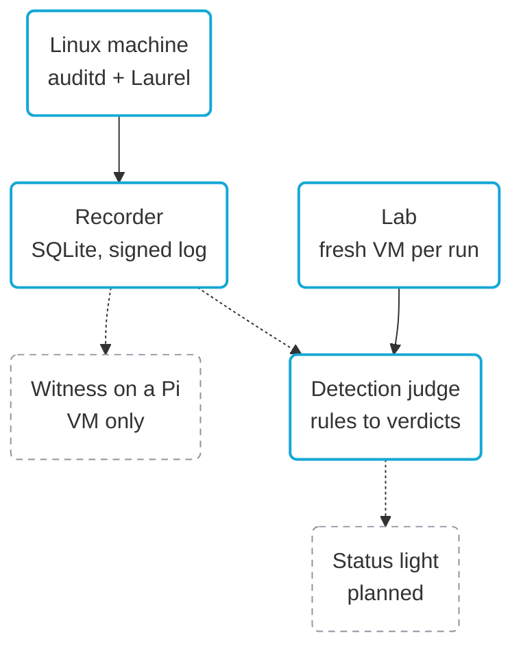

<div align="center">

<h1><picture><source media="(prefers-color-scheme: dark)" srcset=".github/banner-dark.svg"></picture></h1>

**Open-source security for Linux machines where AI agents work.**

[](https://github.com/Balistid/balistid-blue/actions/workflows/ci.yml) [](https://securityscorecards.dev/viewer/?uri=github.com/Balistid/balistid-blue)
[](https://github.com/Balistid/balistid-blue/actions/workflows/fuzz.yml) [](LICENSE) [](go.mod)  [](STATUS.md)

</div>

> [!WARNING]
> Balistid is pre-alpha and does not protect your machine yet. The current state is in [STATUS.md](STATUS.md).

## What it is

AI coding agents run commands, edit files and install packages, and then they tell you what they did. Balistid is meant to guard one Linux machine against attackers, and to show when an agent's actions do not match its report. It is for one machine: no fleet management, no SOC features for many tenants, no hosted service. It does not write a kernel sensor that someone already maintains, and it claims no protection that a test has not shown.

| Part | Question it answers | Today |
|---|---|---|
| Record | What happened on the machine? | runs on one machine, frozen with none of its 43 targets passed |
| Detection | Was that an attack? | rules are measured in the lab, none runs on a machine |
| Lab | Does a rule really work? | running, results below |

Planned: limits on what an agent may do, stopping an attack and undoing a mistaken stop, the state of the machine now, checking what an agent claims, what a package did during install, attacks on Balistid itself, and one light that says whether you have to look.

## First results

A useful rule catches an attack and stays quiet on normal work. Each technique in the lab therefore has a harmless twin that looks almost the same. A rule passes if it catches both variants of the technique and ignores both twins.

| Technique tested | Harmless twin | Rules that passed |
|---|---|---|
| List the files in `/tmp`, hidden ones too | List only the visible ones | 14 of 21 |
| Read the current time | Work out when the machine booted | 0 of 22 |

In the second test 17 rules caught the technique at least once, and every one of them flagged a twin too. Seven AI models wrote three rules each, and the second test also counts one from Gemini. They got a short brief, the rule format and one sample event, without the test scripts. Read the numbers as a test of the lab, not of the models. All 14 passing rules match the one flag that differs, `--almost-all`: seven list flag spellings and name no program, seven match it by a substring such as the letter `a`, so passing here does not mean few false alarms. In the second test the brief did not say what the twins do, and they print the time and zone too. A third test could not be measured: its scripts need `grep` and the VM has none. The [report](lab/results/2026-11-27-pilot.json) has the rest. To count the verdicts yourself you need git, jq and Go 1.27:

```sh
git clone https://github.com/Balistid/balistid-blue && cd balistid-blue
go run ./cmd/balistid-lab table lab | jq -r '.rules[] | select(.counted) | "\(.pair) \([.verdicts[]] | join(" "))"' | sort | uniq -c
```

Each line counts rules with the same four verdicts: two variants, then two twins. Expect `14 tmp-hidden CAUGHT CAUGHT QUIET QUIET` and no such line for `time-now`. `dev-read` was the trial run. The recorded runs are in [lab/windows](lab/windows); comparing them with the originals (`verify`) works only on the machine that made them.

## How it works



Solid lines run today. Dashed ones are planned: the judge reading the recorder, and the status light. The witness runs only in a VM. Root on the machine can still rewrite the signed log, and the witness is meant to close that gap. The recorder is frozen since 16 November 2026, because its hardest parts matter only once an agent has root there, and none has ([ADR 0076](adr/0076-floor-1-first-the-recorder-freezes-unmet.md)). In the lab the verdict is computed outside the VM, from the records it reported. Work goes in floors: 0 is the recorder, 1 is detection, the planned parts follow.

| Built from | Open-source tools |
|---|---|
| Recording | [auditd](https://github.com/linux-audit/audit-userspace), [Laurel](https://github.com/threathunters-io/laurel), [SQLite](https://sqlite.org) |
| Signed log, witness | [Tessera](https://github.com/transparency-dev/tessera), [litewitness](https://github.com/FiloSottile/torchwood), [WireGuard](https://www.wireguard.com), [nftables](https://nftables.org), [ntfy](https://ntfy.sh) |
| Lab | [QEMU](https://www.qemu.org), [mkosi](https://github.com/systemd/mkosi), [bubblewrap](https://github.com/containers/bubblewrap) |

## How it is developed

Changes go through pull requests and CI, under the rules in [ENGINEERING.md](ENGINEERING.md), and the maintainer approves those that touch the paths in [CODEOWNERS](.github/CODEOWNERS). Report vulnerabilities privately, see [SECURITY.md](SECURITY.md); for bugs and ideas open an issue.

## Repository map

CI fails when a directory with tracked files has no row here, or a row names something that is not tracked.

<details><summary><b>Open the map</b></summary>

| Path | Purpose |
|---|---|
| `ENGINEERING.md` | Binding engineering rules (R1–R14) for humans and agents |
| `CLAUDE.md`, `AGENTS.md`, `STATUS.md` | Working instructions for Claude Code and Codex; Current floor, next step, open decisions (overwritten, never appended) |
| `THREAT_MODEL.md` | Threats per floor with their control, proof and honest status |
| `adr/` | Architecture decision records, one page each |
| `acceptance/` | Acceptance numbers per floor, committed before the floor's code |
| `cmd/balistid/` | The unprivileged command-line client (`version` and `status`) |
| `cmd/balistid-range/`, `cmd/balistid-range-guest/` | Range launcher: `build` an image, `run` it once (ADR 0009); Program inside the range VM that checks isolation and the sensor |
| `cmd/balistid-runner/` | Range runner: `build` its image at install, `tick` one evidence run or agent job (ADR 0011) |
| `cmd/balistid-collector/` | Collector daemon: the socket systemd passes, Laurel's lines into the raw store (ADR 0016, 0017) |
| `cmd/balistid-ledger/` | Ledger daemon: the collector's stream into the signed log, over its own socket (ADR 0027) |
| `cmd/balistid-auditstat/` | auditstat daemon: the kernel's audit status every 5 s, the one process with CAP_AUDIT_CONTROL (ADR 0038) |
| `cmd/balistid-relay/` | Relay daemon: the ledger's checkpoints to the witness, the cosigned one kept (ADR 0006, 0026) |
| `cmd/balistid-pi/` | The Pi's watcher daemon: verifies the log against the Pi's witness, alerts the phone through ntfy (ADR 0031) |
| `internal/buildinfo/` | Version string stamped at release build |
| `internal/rangevm/` | Range sandbox, QEMU argv, results parser, verdict, build and retention |
| `internal/rangeguest/` | Parsers for what the guest reads: auditctl, /proc, Laurel JSON, auditd state |
| `internal/rangejob/`, `internal/rangerun/` | Contract between agents and the range runner, starting with the inbox request; The range runner: its record of the inbox (one run per job name and content in 30 days) and quota; it never changes the inbox |
| `cmd/balistid-lab/`, `internal/detect/`, `lab/` | The detection judge and the pilot's data it reads: pairs, rules, imported windows; `job`, `import`, `table`, `verify` (ADR 0077-0080) |
| `internal/anchor/`, `internal/entry/` | The ledger's log: the collector's stream as typed entries in Tessera, signed checkpoints, resume from the log's tail (ADR 0027); The ledger's log entries: typed events of hashes and ranges, their byte encoding and strict decoding (ADR 0026) |
| `internal/relay/`, `internal/cosign/` | The ledger's checkpoints to the witness (c2sp.org/tlog-witness) and back its verified cosignature, the entry bundles to the Pi; holds no signing key (ADR 0006, 0026, 0031); The checkpoint the witness cosigned, verified with both keys; the witness's time from its signed line (ADR 0029) |
| `internal/watch/` | The Pi's side of the log: root recomputed from the relay's bundles, the log's rules, alarms, push (ADR 0031) |
| `internal/link/`, `internal/rawrecord/` | The wire between collector and ledger: typed, length-prefixed frames, decoded strictly (ADR 0027); The stored evidence record: its byte encoding, leaf hash and truncation (ADR 0005) |
| `internal/shard/`, `internal/store/` | Raw records in one SQLite file per shard: append with gap-free seq, seal, verified read (ADR 0005); Shards under a cap: rotation, loss records, reserve, the seal index and recovery after a crash (ADR 0005, 0013) |
| `internal/collector/` | Collector: Laurel's lines to records as evidence, a byte-bounded queue that never blocks Laurel, loss counted per stage (ADR 0016) |
| `internal/status/` | What `balistid status` shows: floor-0 units from systemd, the collector's health report (ADR 0048) |
| `internal/unixsock/`, `internal/wholefile/` | What every service needs from its local sockets: the peer's uid from the kernel, messages to systemd (ADR 0007); Files written whole: temp file, fsync, rename, directory fsync (ENGINEERING.md 7) |
| `internal/auditstat/` | The kernel's audit status over netlink, strictly decoded, and the fixed report auditstat writes for the collector (ADR 0038) |
| `cmd/balistid-install/`, `internal/install/`, `deploy/install/` | `balistid-install`: installs a component only from a MANIFEST the maintainer's FIDO2 key signed, each file checked; compare the key's `SHA256:tbzX99QWbavyFXa2EQ3Ka5kchy7MJh+MPpjEirTZjlI` before the first install (ADR 0053, 0058) |
| `deploy/audit/` | Audit rules; the range image and `balistid-install`'s recorder install them (ADR 0004, 0068) |
| `deploy/auditd/`, `deploy/laurel/`, `deploy/sysctl/` | auditd configuration, the Laurel plugin entry, Laurel's configuration and the kernel settings (io_uring disabled) |
| `cmd/balistid-judge/`, `deploy/judge/` | The host judge: a oneshot as the collector's uid that writes the recorder's state and the users' execs from the sealed store; `view` assigns runs to agents (ADR 0074, 0082) |
| `deploy/collector/`, `deploy/ledger/`, `deploy/auditstat/` | Collector's socket and service units, its user and directories (ADR 0016, 0017); Ledger's service unit, its user and log directory (ADR 0027); auditstat's service unit, its user and its report's group (ADR 0038) |
| `deploy/relay/`, `deploy/net/` | Relay's service unit and its user; it reaches only the Pi's end of the tunnel (ADR 0026, 0031, 0032); The firewall that lets only the relay's uid reach the Pi, the WireGuard tunnel to it, and its user (ADR 0032) |
| `deploy/announce/`, `deploy/pi/` | Units that announce a clean shutdown or suspend through the ledger's control socket (ADR 0030); The Pi's watcher unit, its failure alert and its user, installed on the Pi by hand (ADR 0031) |
| `deploy/runner/` | Range runner's build and tick units, timer, users and directories; `balistid-install` installs them (ADR 0011, 0058) |
| `packaging/laurel/` | PKGBUILD for the pinned Laurel release binary |
| `range/` | mkosi configuration and guest unit of the range image |
| `tools/ci/`, `tools/lab/` | Repository gates (layout and this map, commit lint, pins, secrets, Go), the runner's release manifest, root probes on CI's systemd (`probe_*.py`), their tests; the pilot's blind rule authors (T1) |
| `githooks/`, `.github/` | Local hooks (CI is the authority, they give earlier feedback); CI workflow, code owners, issue and pull request templates |

</details>

## License

Apache License 2.0, see `LICENSE`.
